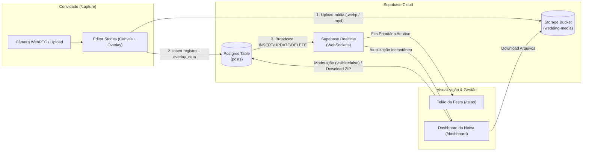

# GabiFotoMural — Especificação de Design (Wedding Stories & Live Wall)

**Data:** 2026-10-21  
**Status:** Aprovado no Brainstorming (Aguardando Revisão Final da Spec)  
**Stack Principal:** Next.js (App Router + TypeScript), SASS/SCSS Modules, Supabase (Storage + Postgres + Realtime), Giphy/Tenor API

---

## 1. Visão Geral e Objetivo

O **GabiFotoMural** é uma aplicação web interativa criada como presente de casamento. Ela permite que os convidados da festa escaneiem um QR Code no salão, tirem selfies, fotos, boomerangs ou vídeos curtos diretamente pelo navegador do celular (sem instalar aplicativo), apliquem edições no estilo Instagram Stories (filtros, textos, emojis e GIFs animados) e enviem para um mural ao vivo.

O sistema é composto por três experiências integradas em tempo real:
1. **Captura & Edição Mobile (`/capture` ou `/`)**: Interface estilo Instagram Stories para os convidados.
2. **Telão Ao Vivo (`/telao`)**: Slideshow fullscreen para TV/Projetor no salão da festa com transições pré-definidas, barra de tempo de 5 segundos e fila prioritária em tempo real.
3. **Dashboard da Noiva (`/dashboard`)**: Painel administrativo elegante com menu lateral (`aside`) para visualizar a galeria, moderar postagens em tempo real e baixar todas as recordações (individualmente ou em pacote `.zip`).

---

## 2. Arquitetura e Stack Tecnológica



### Decisões Técnicas
- **Framework:** Next.js (App Router) com TypeScript.
- **Estilização:** **SASS / SCSS Modules** (`*.module.scss`) com arquitetura de variáveis globais (`_variables.scss`), mixins de responsividade (`_mixins.scss`) e animações (`_animations.scss`). **Sem Tailwind CSS.**
- **Armazenamento e Tempo Real:** Supabase (Free Tier suporta tranquilamente o volume de uma festa de casamento):
  - **Supabase Storage:** Bucket público `wedding-media` para servir imagens e vídeos via CDN com baixa latência no Wi-Fi do salão.
  - **Supabase Database (PostgreSQL):** Tabela única `posts` com índices por `created_at` e `visible`.
  - **Supabase Realtime:** Canal inscrito em mudanças (`INSERT`, `UPDATE`, `DELETE`) na tabela `posts` para atualizar o `/telao` e o `/dashboard` instantaneamente.
- **Estratégia Híbrida de Renderização de Edições (Abordagem A):**
  - **Fotos estáticas (apenas filtro, texto e emojis estáticos):** Achatadas (*flattened*) no cliente via HTML5 `<canvas>` gerando um arquivo `.webp` (ou `.jpg`) final (~300–600 KB). Isso torna o download posterior no Dashboard imediato e idêntico ao que foi criado.
  - **Vídeos curtos, Boomerangs ou Fotos com GIFs animados:** O arquivo de mídia base é enviado diretamente para o Storage sem re-codificação pesada no celular (evitando travamentos ou lentidão), e a camada de edição (filtro CSS, textos, stickers e URLs de GIFs com coordenadas percentuais `x, y`, `scale`, `rotation`) é salva no campo `overlay_data` (`JSONB`). Um componente compartilhado `<StoryRenderer />` reproduz a mídia com a camada de overlay idêntica tanto no Editor quanto no Telão e no Dashboard.

---

## 3. Modelo de Dados e Segurança

### 3.1. Tabela `posts` (PostgreSQL)

| Coluna | Tipo | Restrições / Default | Descrição |
| :--- | :--- | :--- | :--- |
| `id` | `uuid` | `PRIMARY KEY DEFAULT gen_random_uuid()` | Identificador único da postagem |
| `guest_name` | `text` | `NOT NULL` | Nome ou apelido informado pelo convidado |
| `media_url` | `text` | `NOT NULL` | URL pública do arquivo no bucket `wedding-media` |
| `media_type` | `text` | `NOT NULL CHECK (media_type IN ('photo', 'video', 'boomerang'))` | Tipo de mídia capturada |
| `duration_ms` | `integer` | ` NOT NULL DEFAULT 5000` | Tempo de exibição no telão (5000ms para fotos, duração real até 10000ms para vídeos) |
| `has_animated_overlay` | `boolean` | `NOT NULL DEFAULT false` | Indica se o `<StoryRenderer />` deve montar camadas de `overlay_data` sobre a mídia |
| `overlay_data` | `jsonb` | `NULL` | Metadados de filtro e elementos sobrepostos (textos, emojis, GIFs) |
| `visible` | `boolean` | `NOT NULL DEFAULT true` | Se `true`, aparece no `/telao`. Se `false`, fica oculto (moderado) |
| `created_at` | `timestamptz` | `NOT NULL DEFAULT now()` | Data/hora de envio |

### 3.2. Estrutura do `overlay_data` (JSONB)

```json
{
  "filter": "golden-hour",
  "elements": [
    {
      "id": "el_1",
      "type": "text",
      "content": "Viva os noivos! 🥂",
      "x": 50.0,
      "y": 80.5,
      "scale": 1.2,
      "rotation": -5,
      "color": "#FFFFFF",
      "backgroundColor": "rgba(0, 0, 0, 0.6)",
      "fontFamily": "modern"
    },
    {
      "id": "el_2",
      "type": "gif",
      "url": "https://media.giphy.com/media/.../giphy.gif",
      "x": 25.0,
      "y": 20.0,
      "scale": 1.0,
      "rotation": 0
    }
  ]
}
```
*(Coordenadas `x` e `y` armazenadas em porcentagem `0–100%` relativas ao container 9:16 para garantir posicionamento exato em qualquer resolução de celular, TV ou monitor).*

### 3.3. Autenticação e Controle de Acesso
- **Convidados (`/capture`):** Acesso sem senha via QR Code da festa. No primeiro acesso, um modal solicita apenas o nome/apelido e o armazena no `localStorage` (`gabi_guest_name`).
- **Telão (`/telao`):** Leitura pública dos posts onde `visible = true`.
- **Dashboard (`/dashboard`):** Protegido por uma senha simples configurada via variável de ambiente (`DASHBOARD_PASSWORD`). Ao digitar a senha na tela de login do `/dashboard`, uma Server Action / Route Handler valida a senha e grava um cookie `HTTP-only` assinado. Operações de moderação (`UPDATE` / `DELETE` no Supabase) passam por Route Handlers do Next.js que verificam esse cookie e utilizam a `SUPABASE_SERVICE_ROLE_KEY` no servidor, impedindo que convidados apaguem fotos pelo navegador.

---

## 4. Detalhamento das Rotas e Componentes

### 4.1. Rota 1: Dashboard da Noiva (`/dashboard`)
Interface desktop-first (mas responsiva para celular caso alguém queira moderar a fila durante a festa), com visual limpo, elegante (tons claros/champagne/dourado suave em SCSS) e **Aside Bar** fixa à esquerda.

- **Menu Lateral (`<DashboardSidebar />`):**
  - **📸 Fotos (Galeria Principal):** Visualização de todas as mídias enviadas.
  - **🛡️ Moderação / Ocultos:** Filtro rápido para revisar itens que foram ocultados do telão.
  - **🖥️ Kit da Festa (Telão & QR Code):** Atalho para abrir o `/telao` em nova aba e cartão pronto para impressão/exibição com o QR Code de acesso dos convidados.
- **Cabeçalho de Ações da Galeria:**
  - Contador de memórias (ex: *"142 registros enviados • 120 fotos • 22 vídeos"*).
  - Filtro por tipo (*Todos*, *Fotos*, *Vídeos/Boomerangs*) e busca por nome do convidado.
  - Botão de destaque **"Baixar Tudo (.ZIP)"**: Utiliza `JSZip` no cliente com barra de progresso para baixar todas as fotos e vídeos visíveis organizadas com nome do convidado e horário (`001_Maria_23h15.webp`).
- **Cards da Galeria (`<MediaCard />`):**
  - Preview 9:16 (reproduz vídeo ao passar o mouse ou tocar).
  - Nome do convidado e horário do envio.
  - Ações rápidas no card:
    - **Baixar mídia individual** (botão de download direto).
    - **Mostrar/Ocultar no Telão** (toggle instantâneo que atualiza `visible` no banco e remove do telão ao vivo em <1 segundo).
    - **Excluir permanentemente** (com confirmação).

### 4.2. Rota 2: Captura e Editor Estilo Instagram (`/capture`)
Interface 100% mobile-first (`100dvh`, proporção 9:16 centralizada, bloqueio de scroll elástico indesejado).

- **Etapa 1: Identificação Rápida (`<GuestWelcomeModal />`):**
  - Aparece apenas se `localStorage.getItem('gabi_guest_name')` não existir. Campo único *"Como você se chama?"* + botão *"Bora tirar foto!"*. Permite trocar o nome depois clicando no crachá no topo da câmera.
- **Etapa 2: Câmera ao Vivo (`<CameraView />`):**
  - Acesso via `navigator.mediaDevices.getUserMedia({ video: { facingMode, width: { ideal: 1920 }, height: { ideal: 1080 } }, audio: false })` (vídeos estilo mural de telão são mudos por padrão para não conflitar com o DJ/banda da festa, ou áudio opcional no arquivo salvo).
  - Controles na tela:
    - Alternar câmera frontal (com espelhamento horizontal automático no preview e no save) e câmera traseira.
    - Botão de **Upload da Galeria** (canto inferior esquerdo) caso o convidado queira postar uma foto que acabou de tirar com a câmera nativa do iPhone/Android.
    - Seletor de Modo na base do botão disparador: **FOTO** | **BOOMERANG** | **VÍDEO (até 10s)**.
    - Anel de progresso animado em SVG ao redor do botão disparador durante gravação de vídeo ou rajada de Boomerang (~1.5s capturando 12 frames e montando loop suave).
- **Etapa 3: Editor Stories (`<StoryEditor />`):**
  - **2.1 Filtros Pré-definidos (Swipe lateral ou barra inferior):**
    1. *Original* (sem filtro)
    2. *Noiva Glow* (`brightness(1.08) contrast(0.95) saturate(1.1)`)
    3. *Golden Hour* (`sepia(0.25) saturate(1.3) brightness(1.05)`)
    4. *P&B Clássico* (`grayscale(1) contrast(1.15)`)
    5. *Vintage Film* (`contrast(0.9) brightness(1.05) sepia(0.18) hue-rotate(-5deg)`)
    6. *Festa / Alta Vibe* (`saturate(1.4) contrast(1.1)`)
  - **2.1 Ferramenta de Texto (`Aa`):**
    - Abre teclado com overlay de digitação centralizado.
    - Alternância de estilo de fundo (transparente, caixa preta semi-transparente, caixa branca com texto escuro).
    - Paleta de 8 cores rápidas + 3 fontes (*Clássica/Serif*, *Moderna/Sans*, *Manuscrita/Script*).
  - **2.2 Gaveta de Emojis, Stickers do Casamento e GIFs (`<StickerDrawer />`):**
    - Aba **Casamento & Emojis:** Stickers temáticos prontos (ex: *"Team Noiva"*, *"Team Noivo"*, *"Open Bar Approved"*, *"Casamento do Ano"*, além dos emojis mais usados em festas 🥂💍👰🤵🎉❤️🔥).
    - Aba **GIFs (Giphy / Tenor API):** Campo de busca em tempo real de GIFs transparentes (stickers animados) + grade de "Em alta para festas".
  - **Manipulação Touch (`<DraggableOverlay />`):**
    - Qualquer texto, emoji ou GIF adicionado pode ser arrastado com 1 dedo (Pointer Events), redimensionado/rotacionado ou arrastado para a lixeira na base da tela para remover.
  - **Botão "Enviar para o Telão ✨":**
    - Exibe feedback de envio animado e mensagem de confirmação (*"Sua foto já vai aparecer no telão!"*) com botão para tirar outra.

### 4.3. Rota 3: Telão Ao Vivo (`/telao`)
Projetado para rodar em tela cheia (`F11`) em uma Smart TV, notebook conectado ao HDMI do projetor ou painel de LED do salão.

- **Layout Visual (16:9):**
  - **Fundo Dinâmico Ambient Light:** A própria mídia atual preenche os 16:9 do fundo com `filter: blur(45px) brightness(0.45)` e transição suave, eliminando barras pretas laterais.
  - **Palco Central (9:16):** Moldura elegante estilo Story no centro da tela com sombra profunda, exibindo:
    - **Barra de Progresso no Topo:** Preenche linearmente em **5 segundos** para fotos/boomerangs ou na duração exata do vídeo (até 10s).
    - **Crachá do Convidado:** Nome de quem enviou + horário relativo (ou badge dourado *"✨ Acabou de enviar!"* quando vem da fila prioritária).
  - **Painel Lateral Fixo (Canto da Tela):**
    - Chamada convidativa: *"Aponte a câmera do celular e apareça no telão!"* + **QR Code grande e legível** apontando para a URL de `/capture`.
- **Gerenciador de Fila Inteligente (`useSlideshowQueue`):**
  - **Fila Normal (Histórico):** Cicla pelas fotos visíveis da festa em ordem embaralhada ou cronológica recente.
  - **Fila Prioritária (Realtime `INSERT`):** Assim que um convidado envia uma nova foto/vídeo, o evento Realtime insere o item na `priorityQueue`. Ao terminar os 5 segundos do slide atual, o telão exibe imediatamente os itens da `priorityQueue` antes de voltar ao ciclo normal.
  - **Remoção Instantânea (Realtime `UPDATE`/`DELETE`):** Se alguém ocultar uma foto no `/dashboard`, e ela estiver na tela naquele exato segundo, o telão pula imediatamente para a próxima.
- **3.1 Transições Aleatórias Pré-definidas (`_transitions.scss`):**
  A cada troca de slide, o telão sorteia uma das 4 animações CSS/SCSS:
  1. `fade-scale`: Fade suave combinado com leve zoom out (`scale(1.06)` -> `scale(1)`).
  2. `cube-3d`: Rotação 3D lateral idêntica à transição entre diferentes perfis nos Stories do Instagram (`perspective(1200px) rotateY(90deg)`).
  3. `polaroid-drop`: Entrada suave vindo de cima com leve inclinação (`rotate(-2deg)` -> `rotate(0deg)`).
  4. `blur-dissolve`: Transição cinematográfica com desfoque progressivo (`blur(20px)` -> `blur(0px)`).

---

## 5. Estrutura de Pastas do Projeto

```text
c:/Projetos/GabiFotoMural/
├── src/
│   ├── app/
│   │   ├── (guest)/
│   │   │   └── page.tsx                 # Rota de captura/editor dos convidados (/)
│   │   ├── telao/
│   │   │   └── page.tsx                 # Rota do Telão ao vivo (/telao)
│   │   ├── dashboard/
│   │   │   ├── login/page.tsx           # Tela de senha da noiva
│   │   │   └── page.tsx                 # Dashboard com aside bar e galeria (/dashboard)
│   │   ├── api/
│   │   │   ├── auth/route.ts            # Validação da senha do dashboard
│   │   │   └── posts/[id]/route.ts      # Moderação (ocultar/excluir) autenticada
│   │   └── layout.tsx
│   ├── components/
│   │   ├── capture/                     # CameraView, StoryEditor, StickerDrawer, DraggableOverlay
│   │   ├── telao/                       # SlideshowStage, AmbientBackground, QRCodeBanner
│   │   ├── dashboard/                   # DashboardSidebar, MediaGrid, MediaCard, ZipDownloader
│   │   └── shared/                      # StoryRenderer (renderiza mídia + overlay_data JSON)
│   ├── hooks/
│   │   ├── useCamera.ts                 # Controle de MediaStream, foto, boomerang e vídeo
│   │   ├── useSlideshowQueue.ts         # Lógica de fila normal + fila prioritária Realtime
│   │   └── useRealtimePosts.ts          # Assinatura do canal Supabase Realtime
│   ├── lib/
│   │   ├── supabase/                    # Clientes Supabase (browser e server/admin)
│   │   ├── canvasExport.ts              # Flatten de foto + filtro + textos/emojis em .webp
│   │   └── giphy.ts                     # Cliente de busca de GIFs/Stickers animados
│   ├── styles/
│   │   ├── _variables.scss              # Paleta de cores, fontes, z-index e espaçamentos
│   │   ├── _mixins.scss                 # Media queries, glassmorphism, flex/grid helpers
│   │   ├── _transitions.scss            # As 4 transições aleatórias do telão
│   │   └── globals.scss                 # Reset e estilos base
│   └── types/
│       └── post.ts                      # Interfaces TypeScript (Post, OverlayData, OverlayElement)
```

---

## 6. Tratamento de Erros e Casos de Borda

1. **Permissão de Câmera Negada no Celular:** Se o convidado negar acesso à câmera ou se o navegador in-app (ex: leitor de QR antigo) bloquear `getUserMedia`, a tela exibe automaticamente um botão amigável **"Tirar foto com a câmera do celular / Escolher da Galeria"** usando `<input type="file" accept="image/*,video/*" capture="user" />`, garantindo que ninguém fique sem participar.
2. **Oscilação no Wi-Fi do Salão:**
   - No `/capture`: Imagens são comprimidas em `.webp` (qualidade `0.85`, largura máx `1080px`) antes do upload, mantendo arquivos leves (~300KB). Em caso de falha de rede, um botão *"Tentar enviar novamente"* preserva a edição feita sem perder a foto.
   - No `/telao`: As mídias da fila fazem *preload* do próximo slide em background antes da transição de 5 segundos acontecer, evitando tela piscando ou carregando no meio da transição. Se a internet cair temporariamente, o telão continua ciclando normalmente pelas fotos já carregadas em cache.
3. **Telão Vazio no Início da Festa:** Caso o telão seja ligado antes do primeiro convidado postar, ele exibe um *Slide de Boas-Vindas* elegante com os nomes dos noivos e o QR Code em destaque convidando a primeira selfie da noite.

---

## 7. Estratégia de Testes e Verificação

- **Testes Unitários (Vitest):**
  - Validação da lógica da fila de prioridades do Telão (`useSlideshowQueue`: inserção de item novo furando a fila, remoção imediata ao ocultar item, fallback para loop histórico).
  - Serialização e cálculo de coordenadas percentuais (`0–100%`) dos elementos de `overlay_data`.
  - Utilitário de exportação do Canvas (`canvasExport.ts`).
- **Testes de Componentes e Fluxo:**
  - Fluxo completo `/capture`: Identificação -> Captura de foto/vídeo -> Adição de filtro, texto e GIF -> Upload para Storage e banco.
  - Fluxo `/telao`: Recebimento via Realtime, troca a cada 5s com sorteio das 4 transições SCSS.
  - Fluxo `/dashboard`: Login por senha, listagem na galeria via menu lateral `Fotos`, ocultar foto (refletindo no `/telao`) e download individual / `.zip`.
